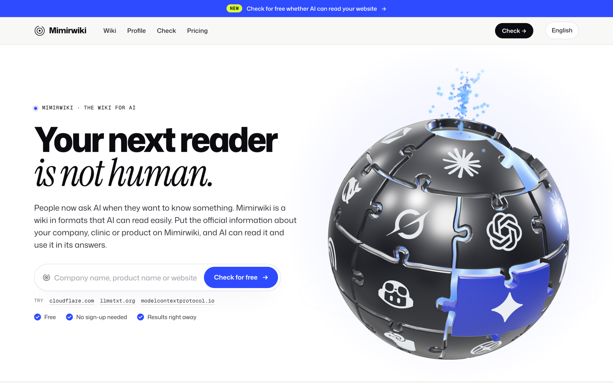

<div align="center">

<a href="https://mimirwiki.com"></a>

# Mimirwiki

**The fountain of wisdom, for AI.**

[](https://mimirwiki.com)
[](https://mimirwiki.com/llms.txt)
[](LICENSE)
[](https://mimirwiki.com/ko)

[Website](https://mimirwiki.com) · [All pages](https://mimirwiki.com/wiki) · [한국어](https://mimirwiki.com/ko) · [Check your website](https://mimirwiki.com/check)

</div>

## What is Mimirwiki?

[Mimirwiki](https://mimirwiki.com) is a wiki for AI answer engines and agents. Each page covers one subject, such as a company, an AI model, a web standard or a medicine, and lists its sources.

People now ask ChatGPT, Claude, Gemini or Perplexity when they want to know something. Mimirwiki publishes pages in formats that these systems can read easily.

## Five formats for every page

| Format | Address |
|---|---|
| HTML | https://mimirwiki.com/wiki/json-rpc |
| Markdown | https://mimirwiki.com/wiki/json-rpc.md |
| Plain text | https://mimirwiki.com/wiki/json-rpc.txt |
| JSON | https://mimirwiki.com/wiki/json-rpc.json |
| JSON-LD | https://mimirwiki.com/wiki/json-rpc.jsonld |

## Read a page

Add the format to the end of the address:

```bash
curl https://mimirwiki.com/wiki/json-rpc.md
```

Or ask for the format with a header:

```bash
curl -H "Accept: text/markdown" https://mimirwiki.com/wiki/json-rpc
```

## Example pages

| AI | Web standards | Other subjects |
|---|---|---|
| [ChatGPT](https://mimirwiki.com/wiki/chatgpt) | [JSON-RPC](https://mimirwiki.com/wiki/json-rpc) | [Nvidia](https://mimirwiki.com/wiki/nvidia) |
| [Claude](https://mimirwiki.com/wiki/claude) | [JSON-LD](https://mimirwiki.com/wiki/json-ld) | [Asundexian](https://mimirwiki.com/wiki/asundexian) |
| [Google Gemini](https://mimirwiki.com/wiki/google-gemini) | [robots.txt](https://mimirwiki.com/wiki/robots-txt) | [SpaceX Starship](https://mimirwiki.com/wiki/spacex-starship) |
| [Grok](https://mimirwiki.com/wiki/grok) | [llms.txt](https://mimirwiki.com/wiki/llms-txt) | [Riemann hypothesis](https://mimirwiki.com/wiki/riemann-hypothesis) |
| [Model Context Protocol](https://mimirwiki.com/wiki/model-context-protocol) | [Sitemaps](https://mimirwiki.com/wiki/sitemaps) | [Rust](https://mimirwiki.com/wiki/rust-programming-language) |

See [all pages](https://mimirwiki.com/wiki).

## In this repository

| Path | Contents |
|---|---|
| [docs/en](docs/en) | All pages in English, as Markdown |
| [docs/ko](docs/ko) | All pages in Korean, as Markdown |
| [docs/README.md](docs/README.md) | The list of pages |
| [FORMAT.md](FORMAT.md) | The page format |

The files in `docs/` are updated when pages are published on mimirwiki.com.

## For AI agents

- [llms.txt](https://mimirwiki.com/llms.txt): a list of all pages with their Markdown addresses
- [llms-full.txt](https://mimirwiki.com/llms-full.txt): the full text of all pages
- [sitemap.xml](https://mimirwiki.com/sitemap.xml)
- [robots.txt](https://mimirwiki.com/robots.txt): AI crawlers are allowed

## Check your website

Enter a website address at [mimirwiki.com/check](https://mimirwiki.com/check) to see how AI systems read it. The check is free and needs no sign-up.

## License

The pages in `docs/` are licensed under [CC BY 4.0](LICENSE). You can copy and adapt them if you credit Mimirwiki and link to the page on mimirwiki.com.

The Mimirwiki name and the image in `assets/` are not covered by this license.

---

<div align="center">

<sub>© 2026 Mimirwiki · Logos and trademarks belong to their owners.</sub>

</div>
